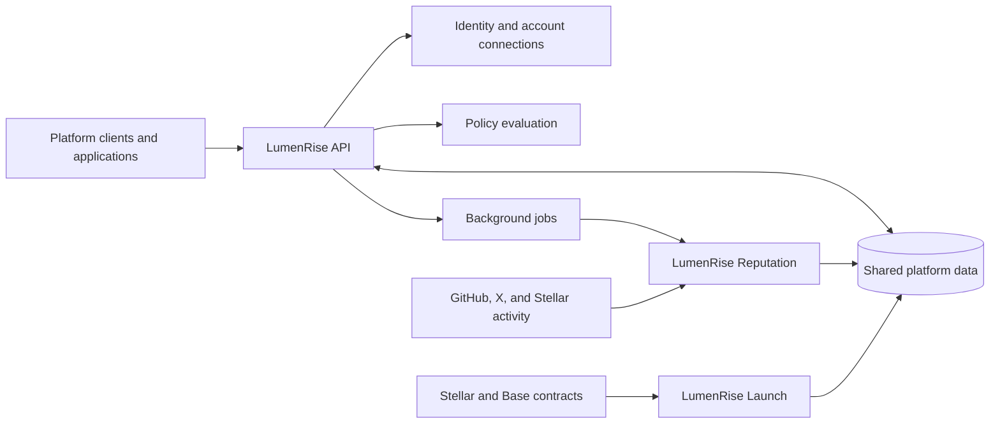

# LumenRise API

**Identity, reputation, and token launch discovery in one application layer.**

LumenRise is a token launch platform that brings project activity and participant reputation into the same experience. It connects linked accounts, verified wallet ownership, explainable reputation, and blockchain market data so users can explore both a project and the activity behind its participants.

The API connects these parts of the platform. It manages identities and project information, makes reputation available to applications, evaluates participation rules, and serves launch data from Stellar and Base.

[Platform architecture](#platform-architecture) | [Core technology](#core-technology) | [API reference](#api-reference) | [Getting started](#getting-started)

## Why LumenRise

Token data tells one part of a project's story. Development history, social relationships, wallet activity, and team information provide additional context. LumenRise brings these signals together while preserving where each observation came from and when it was collected.

Its reputation model keeps developer, social, and Stellar activity as separate dimensions. Applications can choose the evidence that matters to their own participation rules, and users can inspect the signals behind a result.

## Core technology

### Connected identity

A participant's profile connects authentication, linked wallets, and external accounts. GitHub and X connections supply account-specific evidence; verified wallet connections associate on-chain activity with the participant.

Connection state remains part of reputation validity. A score from a previous or disconnected account is excluded from the current profile.

### Explainable reputation

The API assembles a profile from the reputation service's source snapshots and wallet activity scans:

| Dimension | Evidence                                                         | What it describes                       |
| --------- | ---------------------------------------------------------------- | --------------------------------------- |
| Developer | GitHub repositories, contributions, reviews, and account history | Development activity and continuity     |
| Social    | X profile metrics and selected ecosystem relationships           | Social presence and network connections |
| Stellar   | Available activity history of the verified primary wallet        | Observed on-chain participation         |

Scores retain algorithm versions, signal contributions, and source timestamps. Freshness and data coverage stay visible, and unavailable evidence is represented explicitly.

### Policy-based participation

Applications can create immutable policy versions with minimum scores and maximum evidence ages. A policy can require every rule to pass or accept any passing rule.

Evaluations return **eligible**, **ineligible**, or **insufficient data**, with a result for each rule. This preserves the distinction between a participant falling below a threshold and the platform lacking enough current evidence to evaluate them.

For example, an application can require a recent developer score above its chosen threshold, or allow either developer reputation or Stellar activity to satisfy its criteria. Evaluation uses stored evidence, keeping the decision tied to an identifiable snapshot.

### Launch and market discovery

The API combines project descriptions, images, team information, and contract identity with indexed launch state. Clients can explore bonding-curve launches, inspect trades and holders, view price history, and sort projects by recorded activity or graduation progress.

Project preparation and transaction confirmation connect information submitted through LumenRise with the resulting blockchain launch. Chain context and observation timestamps remain attached to market data.

## Platform architecture



| Repository                                                                  | Responsibility                                                                             |
| --------------------------------------------------------------------------- | ------------------------------------------------------------------------------------------ |
| **[lumenrise-api](https://github.com/poconik/lumenrise-api)**               | Identity, project management, reputation access, policy evaluation, and the HTTP interface |
| **[lumenrise-reputation](https://github.com/poconik/lumenrise-reputation)** | External account synchronization, reputation calculations, and activity evidence           |
| **[lumenrise-launch](https://github.com/poconik/lumenrise-launch)**         | Factory discovery, contract state, trades, prices, and holders                             |

The services share MongoDB and use RabbitMQ for background work. The API owns database migrations. Reputation and indexing run independently of HTTP requests so external collection and blockchain synchronization can progress in the background.

## API reference

A running instance provides [Swagger UI](http://localhost:5000/v1/docs/) and the [OpenAPI specification](http://localhost:5000/v1/openapi.json).

| Area                           | Route prefix                        |
| ------------------------------ | ----------------------------------- |
| Authentication and profiles    | `/v1/auth`, `/v1/user`              |
| Linked accounts and reputation | `/v1/connections`, `/v1/reputation` |
| Participation policies         | `/v1/policies`                      |
| Projects and market data       | `/v1/launches`                      |
| Developer integrations         | `/v1/developers`                    |
| Health                         | `/v1/health`                        |

Launch routes use chain-aware request context. Reputation, connected-account, and policy routes are Stellar-specific. Developer API keys provide read access to the key owner's reputation profile; the OpenAPI reference documents authentication and permissions per endpoint.

## Getting started

**Requirements:** Node.js 24+, npm, a MongoDB replica set, and RabbitMQ.

```sh
npm ci
cp .env.example .env
```

Configure `.env` using [`.env.example`](.env.example). Set shared database and broker connections, authentication credentials, blockchain providers and factory contracts, and the integrations you intend to use. OAuth credentials and the 64-character hexadecimal credential encryption key must match the reputation service. Managed Stellar TOML output paths must be writable.

```sh
npm run dev
```

The default address is `http://localhost:5000`. Startup applies database migrations; start the workers after migrations complete. For production, run `npm run build` followed by `npm start`, supplying configuration through environment variables.

**Docker:** [compose.yml](compose.yml) includes the API, MongoDB, and RabbitMQ. Configure `.env`, including `RABBITMQ_PASSWORD`, create the shared network once with `docker network create lumenrise`, then run `docker compose up -d --build`. The API is available at `http://localhost:3002`.

## Engineering

Built with **TypeScript and Node.js**, **Express**, **MongoDB**, and **RabbitMQ**, with **Stellar/Soroban** and **viem** for blockchain access. Cloudflare R2 stores uploaded images.

Run `npm test` for tests, `npm run lint` for code checks, and `npm run format:check` for formatting. The complete command list lives in [`package.json`](package.json).

## License

[MIT](LICENSE).
